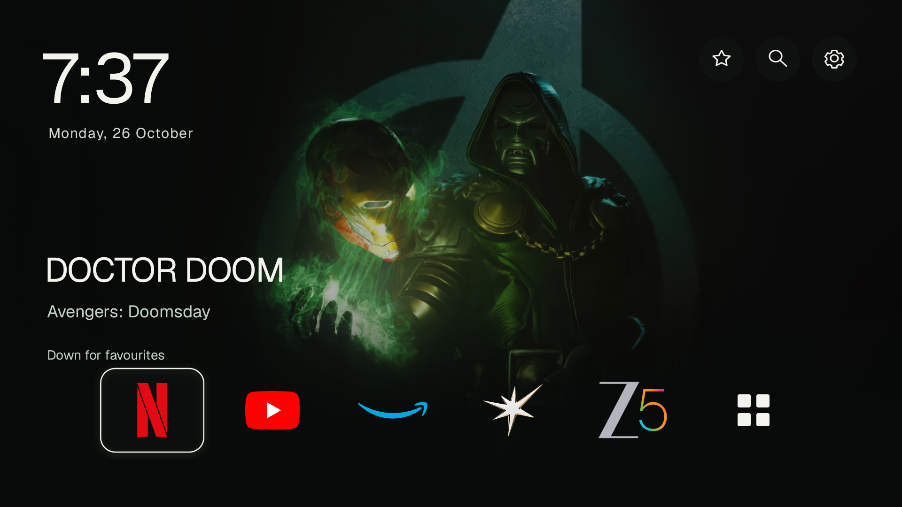
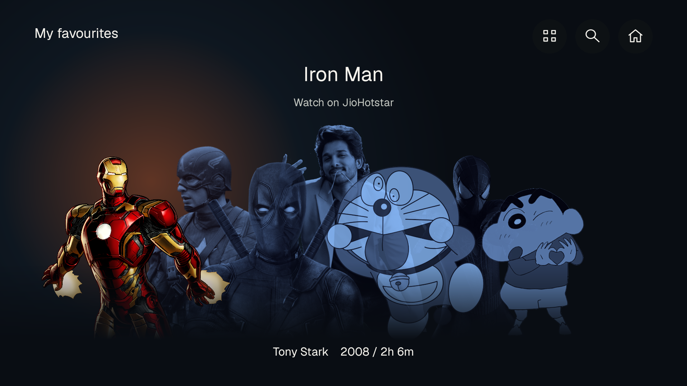
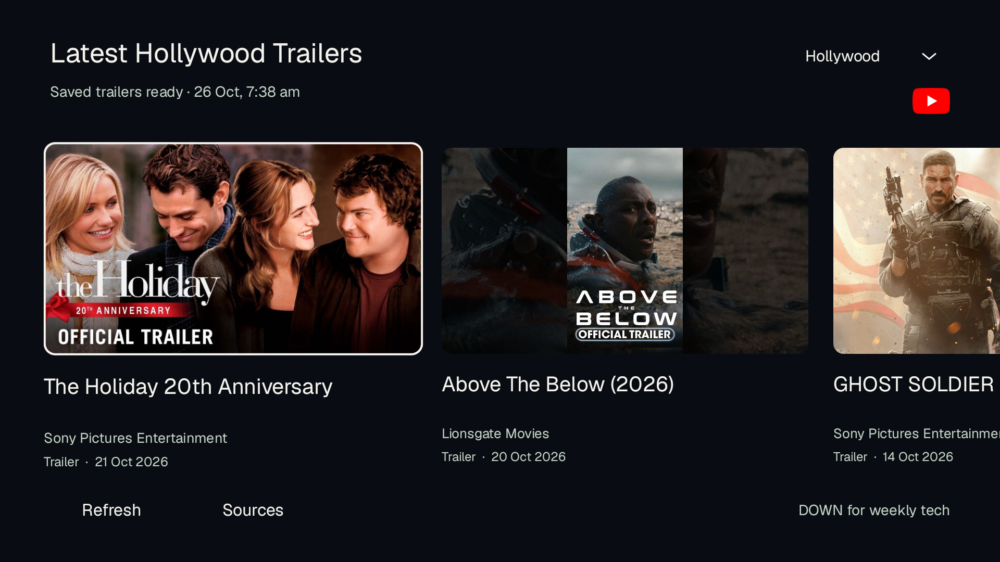
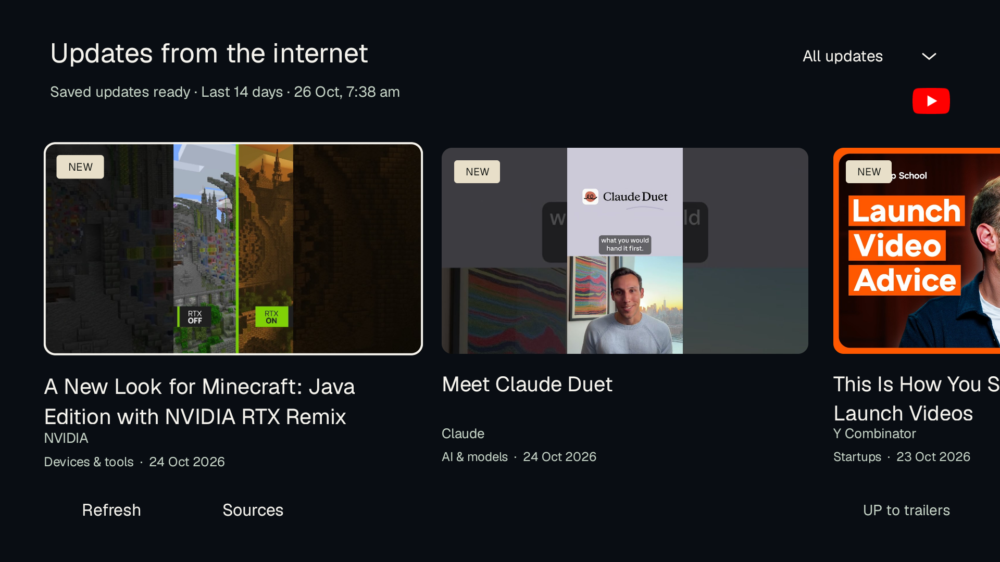
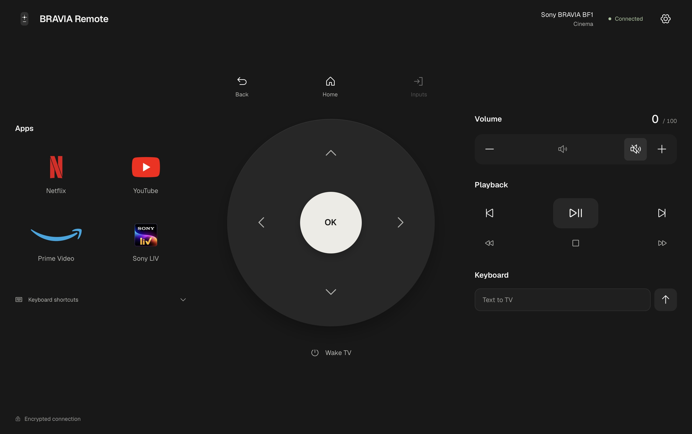

# Cinema BRAVIA

A native cinematic home-screen experience for Android TV, with a local Mac remote.

Built and tested on a **Sony BRAVIA BF1 · Android TV 12 · Mali-G52 · 2.34 GiB RAM**. Cinema uses Java and Android Views; the remote uses AppKit, a local web interface and Android TV Remote v2. No WebView on the television, continuous video backgrounds or always-on Mac backend for the feeds.



## The experience

- **Character navigation.** A remote-controlled character fan, configurable favourites and collection shortcuts that open streaming providers.
- **Floating app dock.** Transparent service logos, clear focus and access to installed TV apps.
- **Live trailers.** Hollywood and Telugu trailers/teasers discovered from a channel-ID allowlist through YouTube Data API v3. Exact-video links open YouTube TV.
- **Tech updates.** A rolling 14-day feed with All updates, AI & models, Startups, Robotics & mobility, Space and Devices & tools. Startups includes recent official Y Combinator uploads.
- **Local Mac remote.** A graphite interface with tactile controls, keyboard navigation, text input where supported, app shortcuts, saved pairing and automatic reconnection over Remote v2 TLS.

Feeds refresh when stale on opening and through an approximate six-hour Android job. Cached results load first; there is no hardcoded video list or required feed backend. Metadata filtering and topic grouping are conservative heuristics, not perfect semantic classification.

| Character navigation | Hollywood trailers |
| --- | --- |
|  |  |
| **Internet updates** | **Mac remote** |
|  |  |

Screenshots are from the actual TV and native Mac application. The film and character artwork depicts a personal setup; it is not included as reusable artwork or covered by the code license. See [asset setup and rights](docs/ASSETS.md).

## Start here

```sh
git clone https://github.com/AnuragTummapudi/cinema-bravia.git
cd cinema-bravia
```

| Component | Setup |
| --- | --- |
| Native TV app | [Build, install and configure Cinema](cinema-launcher/README.md) |
| Mac remote | [Run, pair and build the native window](remote/README.md) |
| Live data | [YouTube key, sources and caching](cinema-launcher/TRAILERS.md) · [Tech feed](cinema-launcher/TECH-UPDATES.md) |
| Project internals | [Architecture](docs/ARCHITECTURE.md) · [Testing and observed limits](docs/TESTING.md) |
| Safety | [Security](SECURITY.md) · [Rollback](cinema-launcher/ROLLBACK.md) |

This source builds a **standalone Cinema app**. It does not register as Android's default Home, disable Google TV, debloat packages or run Sony system changes. Model-specific default-Home/debloat procedures are separate from this repository. Opening a provider page does not guarantee playback, a subscription or regional availability.

## Repository layout

```text
cinema-launcher/   Native TV application, catalogue, source policies and tests
remote/            Local Python server, static UI and native macOS wrapper
docs/              Architecture, setup, testing and screenshots
scripts/           Publication checks
.github/           CI example and contribution templates
```

Raw movie imagery, API keys, remote certificates, device backups, caches, diagnostic dumps, virtual environments and generated installers are excluded. They are not needed to read or test the source. The upstream checkout is also excluded; this is a derivative project, not a vendored copy of CleanYourTV.

## Credits

Thanks to [Gathin](https://www.linkedin.com/in/gathint/) for [CleanYourTV](https://github.com/Gathin23/cleanyourtv), the initial prompt/setup and the lightweight native-launcher starting point. Cinema's character interface, live feeds and Mac remote were developed further for this personal BRAVIA setup.

Remote communication uses [androidtvremote2](https://github.com/tronikos/androidtvremote2). Typography is [Geist](https://github.com/vercel/geist-font); control icons are [Phosphor](https://github.com/phosphor-icons/core). [Third-party notices](NOTICE.md) distinguish code, fonts, marks and artwork.

[MIT license](LICENSE) applies to project code, subject to the included upstream notices. Streaming brands and film/character rights remain with their owners. This project is not affiliated with Sony, Google, YouTube, Amazon, Netflix or the publishers shown.
